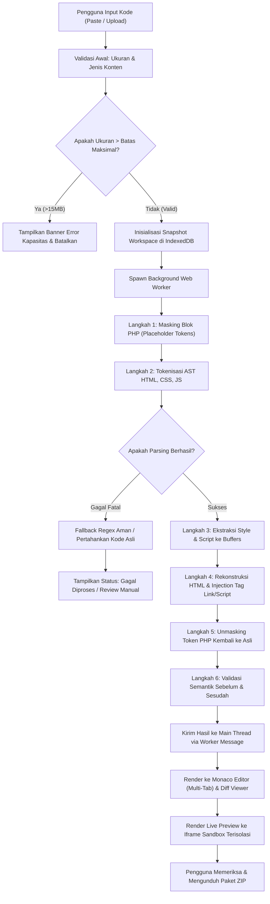
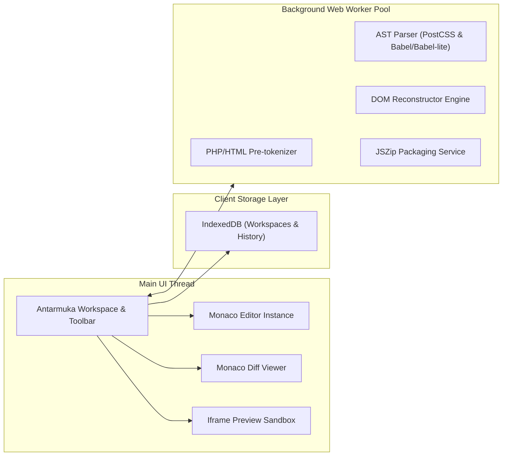
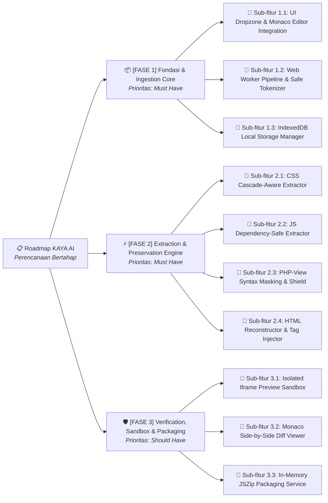

# PRODUCT REQUIREMENTS DOCUMENT (PRD) — KAYA AI

> **Versi:** 2.0.0-PROD  
> **Status Dokumen:** Approved for Implementation (Single Source of Truth)  
> **Target Pengguna & Pelaksana:** AI Coding Agent (Google Antigravity / Cline / Senior Software Engineer)  
> **Platform & Arsitektur:** Web Application — 100% Client-Side In-Browser Processing (Zero-Cloud Transmission)

---

## 1. RINGKASAN PRODUK DAN METADATA

| Item Metadata | Nilai Spesifikasi |
|---|---|
| **Nama Produk** | **KAYA AI** (*Client-First Code Deconstructor & Preservation Engine*) |
| **Kategori Produk** | Developer Productivity Tool / Client-Side Code Architecture Formatter |
| **Arsitektur Utama** | Single Page Application (SPA), Client-Side Web Workers, AST Parsers, Zero-Cloud Transmission |
| **Lingkungan Runtime** | Peramban Modern (Chromium 115+, Firefox 120+, Safari 17+) |
| **Teknologi Inti** | TypeScript / Modern Vanilla JS, Monaco Editor, Prettier Standalone (in Worker), Tree-sitter / PostCSS AST, IndexedDB (Dexie/Native) |
| **Lisensi & Hak Akses** | Proprietary Client Software — Akses Lokal Tanpa Akun Wajib |

### 1.1 Visi Produk
KAYA AI adalah platform web cerdas berbasis *client-first* yang memisahkan, merapikan, dan merekonstruksi file kode monolitik (seperti file HTML/PHP yang mencampurkan markup, CSS internal, JavaScript inline, dan blok kode server-side) menjadi modul-modul berkas terpisah yang bersih, modular, dan terstruktur rapi **tanpa pernah mengubah semantik logika atau merusak perilaku aplikasi asli**.

---

## 2. LATAR BELAKANG DAN MASALAH

### 2.1 Problem Statement
1. **Spaghetti Single-File Code:** Banyak aplikasi web lama, template view PHP (CodeIgniter/Laravel), dan prototipe cepat menumpuk ribuan baris HTML, ratusan tag `<style>`, skrip `<script>` inline, dan event listener `onclick` ke dalam satu file tunggal.
2. **Risiko Refactoring Otomatis:** Tool pembersih kode konvensional (formatter umum/AI generative biasa) sering melakukan *over-optimization*: menghapus variabel global yang dianggap mati (*dead code*), mengubah urutan *cascade* CSS, merusak ekspresi PHP `<?= ... ?>`, atau memecah dependensi skrip JavaScript, sehingga aplikasi menjadi rusak saat dijalankan.
3. **Privasi & Kebocoran Kode Sensitif:** Pengembang sering ragu mengunggah kode sumber internal atau file view berbasis database ke server AI pihak ketiga (Cloud) karena risiko kebocoran data rahasia (*source code leak*).

---

## 3. VISI, TUJUAN, DAN KEY PERFORMANCE INDICATORS (KPI)

### 3.1 Indikator Keberhasilan Terukur

| ID KPI | Metrik Target | Kondisi Pengukuran | Kriteria Sukses |
|---|---|---|---|
| **KPI-01** | **Semantics Preservation Rate** | 500 file benchmark (HTML/CSS/JS/PHP) diuji rendering sebelum vs sesudah | **100% identik secara visual & fungsional** pada mode *Safe* |
| **KPI-02** | **Parsing & Separation Speed** | File 50.000 baris / 5 MB diproses di browser modern | **< 2.500 ms** menggunakan Web Worker (UI thread tetap 60 FPS) |
| **KPI-03** | **Zero Data Leakage** | Audit tab Network DevTools saat pemrosesan berlangsung | **0 request jaringan keluar** untuk konten kode sumber |
| **KPI-04** | **Syntax Crash Resilience** | 100 input dengan HTML tag tak tertutup atau CSS tak valid | **0 kali crash aplikasi**; fallback aman diaktifkan dengan pesan peringatan |

---

## 4. RUANG LINGKUP DAN BATASAN

### 4.1 In Scope (Termasuk dalam Sistem)
* Dekonstruksi berkas monolitik menjadi 3/4 berkas terpisah:
  1. `index.html` (atau file view `.php` bersih dari style & script ekstensif)
  2. `styles.css` (seluruh CSS diekstrak dengan mempertahankan cascade & selector)
  3. `scripts.js` (seluruh JavaScript diekstrak dengan mempertahankan scope & dependency)
* Format dan perapian sintaks independen per bahasa.
* Pemrosesan lokal multi-thread via Web Worker.
* Preview terisolasi via Iframe Sandbox dengan kebijakan keamanan ketat.
* Diff Viewer berdampingan (Before vs After).
* Penyimpanan draft lokal via IndexedDB dengan pelindung kuota.
* Ekspor paket hasil dalam format `.zip` langsung dari memory peramban.

### 4.2 Out of Scope (Batasan Sistem)
* Tidak mengeksekusi kode PHP di browser (PHP hanya diparsing sebagai view-template statis).
* Tidak melakukan konversi framework (misalnya: tidak mengubah CodeIgniter menjadi React).
* Tidak mengubah arsitektur logika bisnis backend.
* Tidak menyediakan penyimpanan cloud tersinkronisasi.

---

## 5. PENGGUNA DAN HAK AKSES

| Peran Pengguna | Deskripsi | Hak Akses Sistem |
|---|---|---|
| **Local User (Default)** | Pengembang / Programmer / QA | Akses penuh lokal: Paste, Upload, Parse, Edit, Format, Preview, Export ZIP, Hapus Workspace. |
| **System Host (Browser)** | Runtime Container | Akses penyimpanan IndexedDB lokal, Web Worker thread, Blob URL generator. |

---

## 6. ATURAN BISNIS (BUSINESS RULES)

| ID Aturan | Nama Aturan | Ketentuan Logis & Penegakan Sistem |
|---|---|---|
| **BR-001** | **Non-Destructive Guarantee** | Input asli pengguna tidak boleh ditimpa secara diam-diam. Seluruh pemrosesan menghasilkan salinan kerja (*working copy*). |
| **BR-002** | **Separation vs Formatting Decoupling** | Tindakan memisahkan berkas (*Deconstruct*) dan tindakan merapikan kode (*Format*) adalah dua modul independen. Pengguna dapat memilih untuk memisahkan kode tanpa memformatnya. |
| **BR-003** | **Explicit Transformation Opt-In** | Tindakan berisiko (misal: ekstraksi inline `style=""` menjadi class atau konversi event handler `onclick` menjadi addEventListener) dinonaktifkan secara default dan membutuhkan persetujuan eksplisit. |
| **BR-004** | **Quota-Aware Purging** | Sistem dilarang menghapus workspace aktif saat memori penuh. Penghapusan cache IndexedDB hanya boleh dilakukan terhadap workspace tertua yang tidak di-pin dan dengan konfirmasi pengguna. |

---

## 7. KEBUTUHAN FUNGSIONAL (FUNCTIONAL REQUIREMENTS)

| ID Fitur | Modul | Deskripsi Perilaku | Prioritas | Acceptance Criteria (Given-When-Then) |
|---|---|---|---|---|
| **FR-001** | Ingestion | Pengguna dapat memasukkan kode via Clipboard Paste, Drag-and-Drop, atau File Browser (.html, .htm, .php). | **Must Have** | **Given** file 10MB diseret ke dropzone, **When** file dilepas, **Then** isi termuat ke editor dalam < 500ms dan jumlah baris terdeteksi. |
| **FR-002** | Worker Extraction | Ekstraksi `<style>` dan `<script>` dijalankan di Web Worker di luar main-thread. | **Must Have** | **Given** input 100.000 baris, **When** tombol Pisahkan diklik, **Then** antarmuka UI tidak freeze (FPS > 55) dan progress bar menampilkan persentase. |
| **FR-003** | PHP-View Shield | Melindungi blok tag server-side `<?php ... ?>` dan `<?= ... ?>` agar tidak rusak oleh HTML parser. | **Must Have** | **Given** kode memuat `<?php if($x): ?><div><?= $x ?></div><?php endif; ?>`, **When** dipisahkan, **Then** seluruh blok PHP utuh tanpa karakter hilang. |
| **FR-004** | Safe Link Injection | Menghubungkan berkas hasil rekonstruksi secara otomatis via `<link rel="stylesheet" href="styles.css">` dan `<script src="scripts.js"></script>`. | **Must Have** | **Given** berkas dipisahkan, **When** HTML direkonstruksi, **Then** tag link ditaruh di akhir `<head>` dan tag script di akhir `<body>`. |
| **FR-005** | Diff Viewer | Tampilan perbandingan Before & After berbasis Monaco Diff Editor. | **Should Have** | **Given** proses selesai, **When** tab Diff dibuka, **Then** bagian yang diekstrak disorot dengan warna hijau/merah. |
| **FR-006** | ZIP Packaging | Kompresi multi-file (`index.html`, `styles.css`, `scripts.js`) langsung di memori lokal. | **Must Have** | **Given** pengguna klik Unduh ZIP, **When** diklik, **Then** file zip terunduh tanpa ada panggilan ke server backend. |

---

## 8. KEBUTUHAN NONFUNGSIONAL (NON-FUNCTIONAL REQUIREMENTS)

| ID NFR | Kategori | Target Spesifikasi & Metrik |
|---|---|---|
| **NFR-001** | **Kapasitas Input** | Mampu memuat hingga **15.000.000 karakter** (setara ~15 MB string) atau **100.000 baris kode** tanpa browser *Out of Memory*. |
| **NFR-002** | **Latensi Eksekusi** | Waktu parsing file standar (20.000 baris) harus selesai dalam **< 1.800 ms** pada CPU benchmark Intel i5 / Apple M1. |
| **NFR-003** | **Responsivitas UI** | Main thread lag tidak boleh melebihi **50 ms** (tidak memicu peringatan Long Task browser). |
| **NFR-004** | **Penyimpanan Lokal** | Maksimal utilisasi IndexedDB adalah **500 MB** dengan peringatan dini pada ambang batas 80%. |
| **NFR-005** | **Aksesibilitas** | Memenuhi standar **WCAG 2.1 AA** (kontras rasio minimal 4.5:1, navigasi keyboard penuh, ARIA role pada tab). |

---

## 9. CODE PRESERVATION CONTRACT

Bagian ini adalah **kontrak hukum teknis mutlak** bagi sistem dan AI coding agent:

### 9.1 Prinsip Preservasi Intransgresibel
1. **Dilarang Refactoring Logika:** Jangan mengganti `var` menjadi `let`/`const`, jangan mengubah fungsi biasa menjadi arrow function, jangan mengubah loop `for` menjadi `.map()`, kecuali pengguna memilih opsi "Modernize" secara eksplisit.
2. **Dilarang Dead-Code Elimination:** Kode yang tampak tidak digunakan (variabel tanpa pemanggil langsung) **wajib dipertahankan 100%**. Variabel tersebut mungkin dipanggil oleh script eksternal atau inline listener di halaman lain.
3. **Preservasi Urutan Cascade CSS:** Seluruh blok CSS yang diekstrak dari beberapa tag `<style>` harus disusun berurutan persis seperti urutan kemunculannya di dokumen HTML asli untuk mencegah perubahan *specificity* dan urutan prioritas *cascade*.
4. **Preservasi Urutan Eksekusi JS:** Tag `<script>` klasik harus diekstrak dan digabungkan dengan mempertahankan urutan deklarasi atas-ke-bawah yang identik.

### 9.2 Klasifikasi Status Hasil Transformasi

```
[Status Transformasi]
├── 1. Berhasil Diproses (Success)
│     └── Transformasi 100% aman, AST valid, tidak ada ambiguitas semantik.
├── 2. Berhasil dengan Peringatan (Success with Warnings)
│     └── Kode dipisahkan, namun ada tag tak tertutup atau CSS spesifik yang berpotensi berubah visual.
├── 3. Memerlukan Pemeriksaan Manual (Requires Manual Review)
│     └── Ditemukan konflik scope JS berat, inline onclick kompleks, atau template PHP dinamis tinggi.
└── 4. Gagal Diproses (Failed - Aborted Safely)
      └── Syntax error fatal; sistem membatalkan transformasi dan mempertahankan input asli utuh.
```

---

## 10. MATRIKS KOMPATIBILITAS (HTML, CSS, JS, PHP)

### 10.1 Matriks Penanganan HTML

| Kasus Input HTML | Perilaku Sistem & Penanganan Ekstraksi | Status Transformasi |
|---|---|---|
| **Dokumen Penuh (`<!DOCTYPE html>`)** | Ekstrak `<style>` ke CSS, `<script>` ke JS. Sisipkan `<link>` di `<head>` dan `<script src>` sebelum `</body>`. | Berhasil diproses |
| **HTML Fragment (Tanpa Head/Body)** | Ekstrak style & script. Pertahankan fragment HTML; sisipkan tag link & script di baris teratas fragment. | Berhasil dengan peringatan |
| **Tag HTML Tidak Tertutup** | Parsing menggunakan toleran HTML tokenizer (DOMParser aman). Jangan memotong konten yang berada di dalam tag menggantung. | Berhasil dengan peringatan |
| **HTML Conditional Comments (`<!--[if IE]>`)** | Pertahankan komentar kondisional di lokasi aslinya. Jangan mengekstrak style di dalamnya ke file CSS umum. | Berhasil dengan peringatan |
| **Inline Event (`onclick="fn()"`)** | **Default:** Biarkan di HTML. **Jika Opt-in Aktif:** Ubah menjadi `addEventListener` di JS dengan penandaan ID unik. | Memerlukan review manual |

### 10.2 Matriks Penanganan CSS

| Kasus Input CSS | Perilaku Sistem & Penanganan Ekstraksi | Status Transformasi |
|---|---|---|
| **Banyak tag `<style>` tersebar** | Gabungkan ke `styles.css` secara berurutan dengan pemisah penanda komentar: `/* --- Extracted from Style Block #X --- */`. | Berhasil diproses |
| **Inline Style (`style="color:red"`)** | **Default: Tetap di HTML**. Ekstraksi ke class CSS dinonaktifkan secara bawaan karena risiko specificity overriding. | Berhasil diproses |
| **CSS At-Rules (`@import`, `@media`, `@layer`)** | `@import` diposisikan di paling atas file CSS hasil ekstraksi sesuai spesifikasi W3C. | Berhasil diproses |
| **Custom Properties (`var(--color)`)** | Pertahankan deklarasi `:root` dan pemanggilan `var()`. Dilarang meng-inline atau me-resolve nilainya. | Berhasil diproses |
| **CSS Minified / Tanpa Spasi** | Parsing token aman. Format ulang hanya jika opsi "Prettify CSS" diaktifkan oleh pengguna. | Berhasil diproses |

### 10.3 Matriks Penanganan JavaScript

| Kasus Input JS | Perilaku Sistem & Penanganan Ekstraksi | Status Transformasi |
|---|---|---|
| **Script Klasik (`<script>`)** | Gabungkan secara berurutan ke `scripts.js`. Bungkus dengan penanda komentar scope jika diperlukan. | Berhasil diproses |
| **Script Module (`type="module"`)** | Jangan dicampur ke dalam file script klasik. Pisahkan ke berkas modular terpisah (`modules.js`). | Berhasil dengan peringatan |
| **Script Eksternal (`<script src="...">`)** | Dilarang memindahkan atau mendownload script eksternal. Biarkan posisinya tetap di dokumen HTML asli. | Berhasil diproses |
| **Atribut `async` / `defer`** | Pertahankan atribut pada tag script aslinya. Jangan otomatis memberi `defer` pada script inline yang diekstrak. | Berhasil diproses |
| **Template Literal dengan Karakter `<>`** | Tokenizer AST JavaScript memastikan string template tidak terpotong sebagai tag HTML. | Berhasil diproses |

### 10.4 Matriks Penanganan Template Server-Side (PHP)

| Kasus Input PHP-View | Perilaku Sistem & Penanganan Ekstraksi | Status Transformasi |
|---|---|---|
| **Tag Standar `<?php ... ?>`** | Lindungi dengan tokenisasi *placeholder token* (misal: `__PHP_BLOCK_001__`) sebelum parsing HTML, lalu kembalikan utuh. | Berhasil diproses |
| **Short Echo Tag `<?= $data ?>`** | Perlakukan sebagai text node atau atribut value aman. Dilarang merusak karakter kurung atau titik koma. | Berhasil diproses |
| **PHP di dalam Tag Atribut** | Contoh: `<div class="<?php echo $cls; ?>">`. Lindungi string atribut tanpa memecah kutip atribut HTML. | Berhasil diproses |
| **PHP Loop Membuka/Menutup Tag** | Contoh: `<?php if($x): ?><div><?php endif; ?></div>`. Jangan biarkan auto-closing parser menutup tag secara prematur. | Memerlukan review manual |

---

## 11. ALUR PENGGUNA DAN ARSITEKTUR SISTEM

### 11.1 Diagram Alur Sistem End-to-End



### 11.2 Diagram Arsitektur Komponen Internal



---

## 12. MODEL DATA DAN PENYIMPANAN (INDEXEDDB SCHEMA)

Sistem menggunakan IndexedDB lokal bernama `KayaAI_LocalDB` versi 2:

### 12.1 Skema Tabel `workspaces`
* `id` (String, Primary Key, UUIDv4)
* `nama` (String, Nama workspace/berkas)
* `dibuat_pada` (Timestamp)
* `diperbarui_pada` (Timestamp)
* `is_pinned` (Boolean, Default: false)
* `ukuran_bytes` (Integer)
* `input_mentah` (Text / Blob)
* `status_terakhir` (Enum: `idle`, `processing`, `success`, `warning`, `error`)

### 12.2 Skema Tabel `workspace_files`
* `id` (String, Primary Key)
* `workspace_id` (String, Foreign Key ke `workspaces.id`)
* `tipe_berkas` (Enum: `html`, `css`, `js`, `php_view`)
* `nama_berkas` (String: `index.html`, `styles.css`, dll)
* `konten` (Text / Blob)
* `hash_sha256` (String, untuk integritas diff)

### 12.3 Skema Tabel `snapshots` (Undo / Redo Buffer)
* `id` (String, Primary Key)
* `workspace_id` (String)
* `urutan_langkah` (Integer)
* `state_payload` (JSON)
* `waktu` (Timestamp)

---

## 13. KEBUTUHAN UI/UX DAN KEADAAN ANTARMUKA

### 13.1 State Manajemen Antarmuka
1. **Empty State:** Menampilkan Dropzone interaktif, tombol "Muat Contoh Kode", dan petunjuk shortcut keyboard (`Ctrl+V`).
2. **Processing / Loading State:** Progress bar persentase (0–100%), nama tahapan aktif (misal: *"Mengekstrak 4 blok CSS..."*), dan tombol **"Batalkan Proses"** yang responsif.
3. **Success State:** Tab editor aktif terisi (`HTML/PHP`, `CSS`, `JS`), badge status hijau ("Berhasil Diproses"), dan tombol "Unduh ZIP" aktif.
4. **Warning State:** Banner kuning di atas editor menjelaskan risiko semantik (misal: *"Ditemukan 2 inline onclick yang dipertahankan di HTML"*).
5. **Error State:** Banner merah dengan penjelasan letak baris galat dan tombol pemulihan *"Kembalikan Input Asli"*.

### 13.2 Navigasi Keyboard & Aksesibilitas
* `Ctrl + Enter` / `Cmd + Enter`: Memulai proses dekonstruksi kode.
* `Ctrl + S` / `Cmd + S`: Menyimpan snapshot manual ke IndexedDB.
* `Alt + 1 / 2 / 3`: Berpindah tab berkas (HTML / CSS / JS).
* Seluruh tombol interaktif memiliki `aria-label` dan kontras rasio warna > 4.5:1.

---

## 14. KEAMANAN DAN PRIVASI (CLIENT-FIRST SECURITY)

### 14.1 Zero-Cloud & Sanitasi Log
* Tidak ada API endpoint eksternal yang menerima konten kode pengguna.
* Logger aplikasi dilarang mencatat cuplikan kode sumber, nama variabel pengguna, atau string konten ke `console.log` di mode produksi.

### 14.2 Iframe Preview Isolation Architecture
Preview dokumen hasil rekonstruksi dirender di dalam Iframe dengan konfigurasi keamanan ketat:
* **Sandbox Attributes:** `sandbox="allow-scripts allow-modals"` (DILARANG KERAS menyertakan `allow-same-origin` bersamaan dengan `allow-scripts` pada origin yang sama untuk mencegah serangan pencurian data IndexedDB atau Session Storage aplikasi induk).
* **Isolation Origin:** Preview dimuat melalui sandboxed Blob URL atau subdomain terisolasi `data:` URI.
* **Network Blocking:** Mencegah kode preview melakukan fetch/XHR ke backend aplikasi utama.

---

## 15. ERROR HANDLING, RECOVERY, DAN WORKSPACE SAFETY

### 15.1 Snapshot & Undo/Redo Engine
* Sebelum pemrosesan dijalankan, sistem otomatis membuat snapshot `pre_process_snapshot`.
* Pengguna dapat menekan tombol **"Batal & Kembalikan Asli"** kapan saja untuk merestorasi buffer input awal 100%.

### 15.2 Worker Failure & Timeout Safeguards
* Jika Web Worker tidak memberikan respons dalam waktu **10.000 ms**, sistem secara otomatis menghentikan (*terminate*) worker tersebut.
* UI menampilkan notifikasi: *"Pemrosesan melebihi batas waktu (timeout). Mencoba metode fallback konservatif..."* tanpa merusak halaman utama.

### 15.3 IndexedDB Quota Protection Policy
* Jika kuota IndexedDB tersisa < 10%, sistem memunculkan dialog konfirmasi:
  > *"Penyimpanan lokal peramban hampir penuh (85%). Apakah Anda ingin membersihkan 5 workspace lama yang tidak disematkan (unpinned)?"*
* Workspace yang sedang dibuka aktif **dilarang dihapus secara otomatis**.

---

## 16. AI CODING AGENT IMPLEMENTATION CONTRACT

Bagian ini adalah **instruksi kerja wajib** untuk AI Coding Agent (seperti Google Antigravity / Cline) yang mengimplementasikan KAYA AI:

### 16.1 Protokol Sebelum Menulis Kode
1. **Wajib membaca PRD ini secara penuh.** Jangan mengambil asumsi di luar ketentuan bab ini.
2. **Pemeriksaan Eksistensi Berkas:** Periksa file yang ada sebelum membuat file baru. Jangan menduplikasi komponen yang fungsinya sudah tersedia.
3. **Patuhi Arsitektur Client-First:** Dilarang menambahkan dependensi backend atau layanan cloud untuk pemrosesan teks kode.

### 16.2 Protokol Selama Implementasi
1. **Pemisahan Modul (Single Responsibility):**
   - Modul Parser hanya bertugas membuat AST dan tokenisasi.
   - Modul Reconstructor hanya bertugas menyusun kembali dokumen.
   - Modul Worker hanya bertugas sebagai execution pipeline off-thread.
   - Modul UI hanya bertugas me-render Monaco dan event handling.
2. **Perubahan Terarah:** Jangan melakukan refactoring menyeluruh pada berkas yang tidak relevan dengan tiket pekerjaan yang sedang ditugaskan.
3. **Dilarang Menghilangkan Error Handling:** Setiap promise wajib memiliki blok `.catch()` dan setiap parser call wajib berada di dalam blok `try-catch`.

### 16.3 Protokol Validasi Setelah Implementasi
1. Jalankan unit test dan linting.
2. Verifikasi bahwa tidak ada error regresi pada pemrosesan file PHP-view.
3. Laporkan daftar berkas yang diubah, fitur yang diselesaikan, dan hasil pengujian aktual secara jujur tanpa rekayasa.

---

## 17. STRATEGI PENGUJIAN DAN TEST CASES MATRIKS

Setiap test case memiliki kriteria kelulusan objektif:

| ID Uji | Kategori | Kondisi Pengujian / Fixture | Langkah Pengujian | Hasil yang Diharapkan | Kriteria Kelulusan |
|---|---|---|---|---|---|
| **TC-001** | HTML Normal | Dokumen HTML5 lengkap dengan 2 `<style>` dan 3 `<script>`. | Masukkan kode -> Klik Pisahkan. | Menghasilkan `index.html`, `styles.css`, dan `scripts.js` yang terhubung valid. | **LULUS** jika rendering preview identik dengan input asli. |
| **TC-002** | PHP-View | File PHP memuat `<?php foreach($x as $y): ?>` dan `<?= $y['nama'] ?>`. | Masukkan kode PHP -> Klik Pisahkan. | Tag PHP tidak terpotong, kurung PHP utuh, variabel tidak berubah. | **LULUS** jika diff blok PHP menunjukkan 0 karakter terhapus. |
| **TC-003** | Malformed HTML | Dokumen memuat tag `<div><p>Teks tanpa tutup div`. | Masukkan kode -> Klik Pisahkan. | Tokenizer tidak melempar uncaught exception; output tetap rapi. | **LULUS** jika status menghasilkan "Success with Warnings". |
| **TC-004** | Inline Script Dependencies | Script baris 50 mendefinisikan `var CONFIG = {}`, script baris 100 memanggil `CONFIG.api`. | Ekstrak ke `scripts.js`. | Urutan deklarasi di `scripts.js` tetap baris 50 dulu lalu baris 100. | **LULUS** jika tidak ada runtime error `CONFIG is undefined`. |
| **TC-005** | Heavy File Stress Test | File HTML gabungan berukuran 10 MB (80.000 baris). | Paste file -> Ukur waktu eksekusi Worker. | Proses selesai dalam waktu < 2.500 ms tanpa crash memori. | **LULUS** jika UI tab responsif dan memori browser stabil. |
| **TC-006** | Sandbox Isolation | Script pengguna di input memuat `window.top.localStorage.clear()`. | Buka tab Live Preview. | Eksekusi script dihentikan oleh sandbox browser. LocalStorage aplikasi utama aman. | **LULUS** jika muncul SecurityError di console iframe dan data aman. |

---

## 18. DEFINITION OF DONE (DoD)

Sebuah fitur atau tahapan implementasi dinyatakan **SELESAI (DONE)** hanya jika memenuhi seluruh daftar periksa berikut:
- [x] Kode sumber ditulis sesuai spesifikasi bab terkait di PRD ini.
- [x] Tidak ada pelanggaran terhadap *Code Preservation Contract* (Bab 9).
- [x] Seluruh unit test untuk kasus normal, edge-case, dan syntax error lolos verifikasi.
- [x] Bebas dari error TypeScript / Linting / Runtime console.
- [x] Preview terisolasi di Iframe sandbox teruji aman dari akses data utama.
- [x] Performa eksekusi memenuhi ambang batas KPI (< 2.500 ms untuk file uji standar).
- [x] Dokumentasi teknis dan laporan implementasi disajikan secara transparan.

---

## 19. RISIKO DAN MITIGASI

| ID Risiko | Kategori | Deskripsi Risiko | Dampak | Probabilitas | Strategi Mitigasi Konkret |
|---|---|---|---|---|---|
| **RSK-01** | Teknis | Parser HTML memformat ulang tag PHP yang menyebabkan error sintaks di engine PHP. | Tinggi | Sedang | Menerapkan sistem *masking regex placeholder token* unik sebelum parsing HTML, dan melakukan *unmasking* setelah rekonstruksi selesai. |
| **RSK-02** | Performa | File ekstrem (> 15 MB) memicu browser tab crash karena keterbatasan heap v8. | Tinggi | Rendah | Memberikan validator batas file di sisi UI sebelum masuk ke Worker thread; membagi chunk input jika diperlukan. |
| **RSK-03** | Keamanan | Iframe preview mengeksekusi skrip berbahaya yang mencoba membaca state workspace. | Kritis | Rendah | Mengunci atribut iframe dengan `sandbox="allow-scripts"` murni tanpa `allow-same-origin` dan menggunakan origin Blob terisolasi. |
| **RSK-04** | Data Loss | Browser menutup tiba-tiba saat pengguna sedang menyunting kode. | Sedang | Sedang | Mengaktifkan background auto-save ke IndexedDB setiap 3 detik pasca perubahan input. |

---

## 20. OPEN QUESTIONS & DECISIONS

| ID Keputusan | Topik Pertanyaan Terbuka | Status Keputusan | Rekomendasi Default yang Ditetapkan |
|---|---|---|---|
| **OQD-01** | Apakah perlu mendukung konversi CSS inline `style="..."` menjadi CSS utility classes? | **DITUNDA (Fase 2)** | Default **TIDAK**. Terlalu berisiko merusak spesifisitas selektor. Tetap pertahankan inline style di HTML pada MVP. |
| **OQD-02** | Apakah perlu menambahkan formatter SCSS/SASS selain CSS biasa? | **DITOLAK untuk MVP** | Fokus hanya pada CSS murni standar W3C agar bundle parser tetap ringan di bawah 3 MB. |
| **OQD-03** | Bagaimana penanganan tag `<script type="text/template">`? | **DISETUJUI** | Dilarang diekstrak ke `scripts.js`. Perlakukan sebagai elemen markup HTML biasa di `index.html`. |

---

## 21. ROADMAP DAN PRIORITAS IMPLEMENTASI



---

## 22. GLOSARIUM ISTILAH TEKNIS

* **AST (Abstract Syntax Tree):** Representasi struktur hierarkis kode program dalam bentuk pohon data sebelum direkonstruksi atau diformat ulang.
* **Code Preservation Contract:** Kesepakatan arsitektur teknis yang menjamin kode asli tidak akan diubah semantiknya, dihapus fungsinya, atau diubah variabelnya tanpa izin eksplisit.
* **Zero-Cloud Transmission:** Prinsip keamanan di mana 100% pemrosesan komputasi terjadi di memori peramban pengguna tanpa mengirim paket data apa pun ke server jarak jauh.
* **Short Echo Tag (`<?= ... ?>`):** Sintaks ringkas bahasa pemrograman PHP untuk mencetak nilai variabel secara langsung ke dalam view HTML.
* **Cascade Specificity:** Bobot prioritas selektor CSS yang menentukan aturan gaya mana yang diterapkan peramban ketika terjadi benturan aturan.
* **Web Worker:** Fitur peramban yang memungkinkan skrip komputasi berat berjalan di thread latar belakang terpisah dari thread antarmuka utama (Main Thread).
